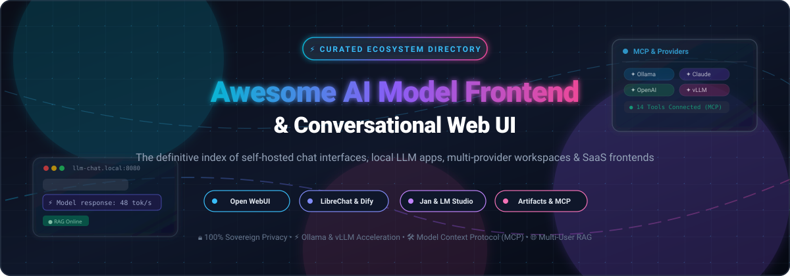

# Awesome-AI-Model-Frontend-Conversational-Web-UI 🚀

  
  
  
  
  
  

### 🌟 Top AI Model Frontend, Self-Hosted Chat Interfaces & Conversational Web UI Ecosystem

**A curated index of production-ready SaaS platforms and self-hosted open-source WebUIs for interacting with local LLMs (Ollama, vLLM, llama.cpp) and multi-provider foundation APIs (OpenAI, Anthropic, Google Gemini, DeepSeek).**

*Featuring interactive code Artifacts, autonomous Agent tool workflows, Model Context Protocol (MCP) clients, hybrid RAG document chat, and offline-first desktop apps.*

---

## 📖 Table of Contents

- [⚡ Sector Overview & Market Dynamics](#-sector-overview--market-dynamics)
- [☁️ SaaS & Hosted Conversational Platforms](#️-saas--hosted-conversational-platforms)
- [💻 Open-Source GitHub Projects](#-open-source-github-projects)
  - [🏆 Category Leaders & Full-Featured Web UIs](#-category-leaders--full-featured-web-uis)
  - [🖥️ Desktop Apps & Local Inference Runners](#️-desktop-apps--local-inference-runners)
  - [🧩 Agent Builders, Workflow Hubs & Frameworks](#-agent-builders-workflow-hubs--frameworks)
  - [🛠️ Developer Toolkits, Libraries & Gateways](#️-developer-toolkits-libraries--gateways)
- [📈 Star History](#-star-history)
- [💖 Support & Sponsorship](#-support--sponsorship)
- [🤝 How to Contribute](#-how-to-contribute)
- [📄 Disclaimer & License](#-disclaimer--license)

---

## ⚡ Sector Overview & Market Dynamics

The global conversational AI and LLM frontend market is valued at approximately **$14.5B–$17.3B in 2025–2026** and projected to exceed **$45B by 2030**, advancing at a robust compound annual growth rate (**CAGR of ~23.5%**).

From a structural standpoint, the market demonstrates a distinct **two-tier hybrid dynamic**:
1. **Foundation & Compute Layer (Highly Concentrated / Winner-Take-Most):** High-capital foundation models and frontier cloud ecosystems remain concentrated among hyperscale labs (OpenAI, Anthropic, Google, Microsoft, Meta).
2. **Frontend, Interface & Workflow Layer (Moderately to Highly Fragmented):** User interfaces, enterprise chat frontends, and developer tooling are actively fragmenting. Organizations and privacy-focused developers increasingly decouple inference from the presentation layer—favoring sovereign open-source WebUIs (Open WebUI, LibreChat), extensible Model Context Protocol (MCP) clients, and multi-provider aggregators rather than vendor-locked proprietary silos.

---

## ☁️ SaaS & Hosted Conversational Platforms

The table below catalogs notable hosted conversational web UIs, multi-model playgrounds, and enterprise AI workspaces. Sorted in descending order by **Company Valuation / Scale**.

| Product | Company / Scale (Valuation or Revenue) | Pricing (Starting Tier) | Free Tier Limits / Trial Limits | Key Highlights & Core Capabilities |
| :--- | :--- | :--- | :--- | :--- |
| **[ChatGPT Web](https://chatgpt.com)** | **$500B Valuation** (~$13.1B ARR) | **$20/mo** (Plus plan) | **Free Forever Plan:** Unlimited access to GPT-4o mini, dynamic rate-limited access to GPT-4o, interactive Canvas editor, custom GPT store, and web search. | 🧠 Flagship cloud interface featuring Canvas code/document editor, real-time Advanced Voice Mode, Deep Research agent, and unified memory. |
| **[Claude.ai](https://claude.ai)** | **$61B+ Valuation** (~$4.5B ARR) | **$20/mo** (Claude Pro) | **Free Forever Plan:** Access to Claude 3.5 Sonnet / Haiku with strict rolling limits (~30–40 messages every 5 hours during standard traffic). | 🎨 Groundbreaking live React/SVG/HTML Artifacts, collaborative Projects knowledge bases, and Model Context Protocol (MCP) tool integration. |
| **[Perplexity AI](https://perplexity.ai)** | **$20B Valuation** (~$230M ARR) | **$20/mo** (Pro plan) | **Free Forever Plan:** Unlimited standard search queries, plus exactly 5 Pro multi-step search queries every 4 hours. | 🔍 Conversational AI answer engine combining multi-model reasoning (Claude, GPT, DeepSeek) with real-time academic and web citations. |
| **[OpenRouter Chat](https://openrouter.ai)** | **$7B–$7.5B Valuation** (~$150M ARR) | **Pay-as-you-go** (From $0.0001/1K tokens; $5 minimum balance top-up) | **Free Forever Plan:** 100% free daily chat access to 25+ open-weights models (including Llama 3, Mistral, and DeepSeek) with dynamic rate limit (~20 req/min). | 🌐 Web playground connected to a unified API gateway routing 400+ frontier and open models side-by-side with lowest-latency fallbacks. |
| **[You.com](https://you.com)** | **$1.5B Valuation** (~$45M ARR) | **$20/mo** (YouPro plan) | **Free Forever Plan:** Unlimited basic web AI search queries, plus 5 premium AI model queries per day. | 🧭 Multi-model conversational workspace with autonomous research agents, custom team data connectors, and transparent citation routing. |
| **[Poe](https://poe.com)** | **$500M Valuation** (Quora) | **$19.99/mo** (or $199.99/year) | **Free Forever Plan:** 3,000 free computation points daily (resets every 24 hours), sufficient for ~30–50 basic model prompts per day. | 🤖 Universal aggregator bot platform allowing simultaneous multi-bot comparisons, custom server bot creation, and creator monetization. |
| **[Dify Cloud](https://dify.ai)** | **$180M Valuation** (LangGenius) | **$59/mo** (Professional plan) | **Free Forever Plan:** 200 free vector storage indexing runs, 100 free AI message credits per month, and up to 10 hosted agent apps. | ⚡ Hosted visual LLM orchestration studio offering drag-and-drop RAG pipelines, multi-model tool routing, and instantly published web chat apps. |
| **[LM Studio Hub](https://lmstudio.ai)** | **$19.3M Funding** (~$1.8M ARR) | **$15/user/month** (Enterprise License; Free for Personal Use) | **Free Forever for Personal Use:** 100% free offline usage with zero message limits or watermarks across all local GGUF/MLX models. | 💻 Polished desktop interface and developer model hub for downloading, fine-tuning, and hosting local LLMs with an OpenAI-compatible server. |
| **[TypingMind](https://typingmind.com)** | **Bootstrapped** (~$1.8M ARR) | **$39 one-time** (Standard lifetime license; BYOK) | **Free Forever Plan:** Permanent free access to basic chat UI using your own OpenAI/Claude/Gemini API keys, limited to 5 AI characters and no cloud backup. | 🔑 High-performance commercial Bring-Your-Own-Key (BYOK) web and desktop interface featuring custom agent personas, Artifacts, and MCP plugins. |

---

## 💻 Open-Source GitHub Projects

Curated open-source chat frontends, desktop clients, self-hosted web apps, and developer toolkits. Each entry features a live GitHub Stars_Count badge linked directly to its repository stargazers page. Sorted in descending order by **GitHub_Stars**.

### 🏆 Category Leaders & Full-Featured Web UIs

* **[Ollama](https://github.com/ollama/ollama)**   
  🦙 The de facto industry standard engine for packaging, running, and managing local LLMs (DeepSeek, Llama 3, Mistral, Qwen) with a built-in REST API and companion web ecosystem.

* **[Dify](https://github.com/langgenius/dify)**   
  🛠️ Production-grade open-source LLM app development and visual orchestration platform featuring visual agent workflows, hybrid RAG knowledge bases, and ready-to-deploy chat interfaces.

* **[Open WebUI](https://github.com/open-webui/open-webui)**   
  🌟 Comprehensive self-hosted WebUI (`BSD-3-Clause`) for Ollama and OpenAI-compatible APIs featuring RAG file uploads, voice/video calls, Python tool execution, user management, and prompt stores.

* **[NextChat](https://github.com/ChatGPTNextWeb/NextChat)**   
  ⚡ Ultra-lightweight, one-click deployable cross-platform web and desktop interface (Next.js & Tauri) for OpenAI, Claude, and local Ollama models with persona masks and message compression.

* **[LobeChat](https://github.com/lobehub/lobe-chat)**   
  🎨 Modern conversational web UI and agent framework (`MIT`) offering interactive Artifacts, plugin and MCP marketplaces, multi-modal vision/audio, and multi-model provider routing.

* **[GPT4All](https://github.com/nomic-ai/gpt4all)**   
  🖥️ Privacy-first desktop application and ecosystem by Nomic AI for running quantized local LLMs on everyday consumer hardware with local document RAG (LocalDocs).

* **[AnythingLLM](https://github.com/Mintplex-Labs/anything-llm)**   
  📦 All-in-one private desktop and Docker AI workspace (`MIT`) featuring drag-and-drop document embeddings, multi-user permissions, autonomous agents, and embeddable chat widgets.

* **[LiteLLM](https://github.com/BerriAI/litellm)**   
  🛡️ Blazing-fast proxy gateway with a Rust core and Python SDK that unifies 100+ LLMs behind a standardized OpenAI-compatible API with load balancing, spend tracking, and rate limits.

* **[Flowise](https://github.com/FlowiseAI/Flowise)**   
  🧩 Drag-and-drop visual UI builder for LangChain and LlamaIndex to orchestrate LLM agents, memory, tools, and conversational web interfaces with zero code.

* **[Cherry Studio](https://github.com/CherryHQ/cherry-studio)**   
  🍒 Cross-platform desktop client (`AGPL-3.0`) supporting simultaneous multi-model chat comparisons, 300+ AI assistant personas, local document knowledge bases, and MCP plugins.

* **[LocalAI](https://github.com/mudler/LocalAI)**   
  🔌 Drop-in, zero-dependency self-hosted replacement for OpenAI API specs that executes LLMs, audio generation, and image synthesis locally on standard CPU/GPU hardware.

* **[Text Generation WebUI](https://github.com/oobabooga/text-generation-webui)**   
  🎛️ The definitive Gradio interface (`AGPL-3.0`) for power users running local models across `llama.cpp`, `ExLlamaV2`, `Transformers`, and `TensorRT-LLM` with deep parameter tuning.

* **[LibreChat](https://github.com/danny-avila/LibreChat)**   
  ✨ Enhanced open-source (`MIT`) ChatGPT/Claude clone featuring custom autonomous Agents, Code Interpreter sandbox, interactive Artifacts, MCP server support, and enterprise OAuth/LDAP.

* **[Jan](https://github.com/menloresearch/jan)**   
  🔒 Open-source (`Apache-2.0`) offline-first desktop conversational client and local OpenAI-compatible server that runs GGUF models on device with zero data telemetry.

* **[Gradio](https://github.com/gradio-app/gradio)**   
  📊 Versatile Python framework for rapidly creating customized machine learning and streaming conversational chat web interfaces in just a few lines of code.

* **[Chatbox](https://github.com/chatboxai/chatbox)**   
  💬 Cross-platform desktop and web conversational client (`GPL-3.0`) supporting OpenAI, Anthropic, Gemini, DeepSeek, and Ollama with local file chat and code preview.

* **[FastChat](https://github.com/lm-sys/FastChat)**   
  ⚡ Open platform for training, serving, and evaluating LLM-based conversational assistants that powers the famous LMSYS Chatbot Arena.

* **[CopilotKit](https://github.com/CopilotKit/CopilotKit)**   
  🧩 Open-source framework for embedding generative UI, in-app autonomous AI agents, and conversational sidebars directly into modern React/Next.js web applications.

* **[Khoj](https://github.com/khoj-ai/khoj)**   
  🧠 Self-hostable AI second brain and desktop/web interface that searches and reasons over personal notes, documents, and web content with voice integration.

* **[SillyTavern](https://github.com/SillyTavern/SillyTavern)**   
  🎭 Power-user local-first frontend (`AGPL-3.0`) engineered for conversational AI roleplay, complex persona prompt management, TTS/STT voices, and world lorebooks.

* **[OpenClaude](https://github.com/Twigpine/openclaude)**   
  👁️ Elegant open-source Claude-inspired chat interface featuring live code preview, interactive Artifacts, and seamless multi-model provider switching.

* **[Chatbot UI](https://github.com/mckaywrigley/chatbot-ui)**   
  🤖 Clean, minimalist open-source (`MIT`) web chat client crafted with Next.js and Supabase supporting custom assistants, prompt folders, and multi-model APIs.

* **[FastGPT](https://github.com/labring/FastGPT)**   
  🏢 Enterprise-ready knowledge-base question-answering platform featuring visual workflow orchestration, hybrid vector search, and customizable chat widgets.

* **[assistant-ui](https://github.com/assistant-ui/assistant-ui)**   
  ⚛️ Production-ready TypeScript/React component library for building modern conversational AI user interfaces, threaded chats, and generative components.

* **[Chainlit](https://github.com/Chainlit/chainlit)**   
  🐍 Python package (`Apache-2.0`) tailored for crafting conversational AI web UIs in minutes with native streaming, thought step visualizations, and multimodal inputs.

* **[KoboldCpp](https://github.com/LostRuins/koboldcpp)**   
  🕹️ Zero-dependency standalone binary runner bundled with **KoboldAI Lite**—a responsive web interface supporting local chat, instruct, and creative writing modes.

* **[Hugging Face Chat UI](https://github.com/huggingface/chat-ui)**   
  🤗 The open-source SvelteKit codebase powering **HuggingChat**, featuring web search grounding, model selector, tool plugins, and multimodal chat.

* **[Big-AGI](https://github.com/enricoros/big-AGI)**   
  🌐 Personal generative AI suite (`MIT`) featuring multi-model "Beam" response synthesis, voice conversations, code execution sandbox, and visual diagram rendering.

* **[Enchanted](https://github.com/gluonfield/enchanted)**   
  🍎 Elegant native SwiftUI application for macOS, iOS, iPadOS, and visionOS designed to connect seamlessly to local Ollama servers and private WebUIs.

* **[Hollama](https://github.com/fmaclen/hollama)**   
  🎯 Lightweight, distraction-free SvelteKit web client engineered specifically for chatting with local Ollama endpoints without external tracking.

---

## 📈 Star History

---

## 💖 Support & Sponsorship

If you find this curated directory helpful for navigating the AI frontend and conversational UI ecosystem, please consider supporting the project:

- ⭐ **Star this repository** to help others discover it on GitHub.
- 🍴 **Fork the repo** and submit pull requests to add new tools or keep information current.
- 📢 **Share with colleagues & communities** exploring self-hosted and cloud conversational AI frontends.
- ☕ **Buy me a coffee / Sponsor the project**: Support ongoing maintenance through the [GitHub Sponsors Dashboard](https://github.com/sponsors/ishandutta2007).

Your support keeps this directory independent, accurate, and actively maintained! ✨

---

## 🤝 How to Contribute

Contributions from the open-source and AI community are warmly welcome!

1. Fork this repository.
2. Create a new branch: `git checkout -b add-new-frontend-tool`.
3. Add the project or SaaS platform into the appropriate table or list (ensure descriptions are factual, pricing is specified, and links are valid).
4. Commit your changes: `git commit -m 'feat: add new conversational AI frontend'`.
5. Push to the branch: `git push origin add-new-frontend-tool`.
6. Open a Pull Request for review!

---

## 📄 Disclaimer & License

- **Disclaimer:** All product names, logos, trademarks, and registered trademarks belong to their respective owners. Mention in this repository is strictly for educational, informational, and indexing purposes.
- **License:** Released under the [MIT License](LICENSE).
